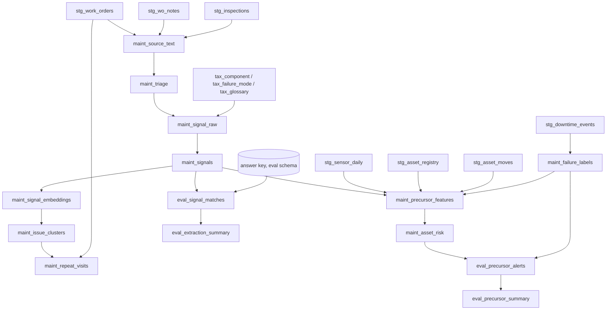

# Materializing the pipeline as a dbt project

The pipeline can be built as plain SQL or as a **dbt project deployed into Snowflake**. dbt is the
better default once the build is past first demo: version control on prompts and taxonomy mappings,
a real DAG, lineage from a risk score back to the note that drove it, and dbt tests as
**build-failing** gates on the correctness rules -- most importantly the precursor cutoff assertion,
which should never be a report somebody forgets to read.

**Delegate the dbt mechanics.** This file covers what the models are and why each is materialized as
it is. For `snow dbt deploy`, `EXECUTE DBT PROJECT`, versioning, scheduling and CI, load the
**`dbt-projects-on-snowflake`** skill.

## Phase-to-model mapping

```
staging/        stg_work_orders              view
                stg_wo_notes                 view
                stg_inspections              view
                stg_asset_registry           view
                stg_asset_moves              view
                stg_sensor_daily             view
                stg_downtime_events          view

taxonomy/       tax_component                table   (seeded from customer tables or dbt seeds)
                tax_failure_mode             table
                tax_glossary                 table

extraction/     maint_source_text            table   (unified, deduplicated, hashed)
                maint_triage                 incremental
                maint_signal_raw             incremental
                maint_signals                incremental
                pipeline_quality_log         incremental

recurring/      maint_signal_embeddings      incremental
                maint_issue_clusters         table
                maint_repeat_visits          table

precursor/      maint_failure_labels         table
                maint_precursor_features     table
                maint_asset_risk             incremental

evaluation/     eval_signal_matches          incremental
                eval_extraction_summary      incremental
                eval_precursor_alerts        incremental
                eval_precursor_summary       incremental
                eval_cost                    incremental
```



## Materialization choices

| Layer | Materialization | Reason |
|---|---|---|
| `staging` | `view` | Renaming and type coercion only. |
| `taxonomy` | `table` | Small, pinned by `taxonomy.version`; a table makes the version visible at rest. |
| `maint_source_text` | `table` | Dedup and hashing happen once. A view would re-hash on every downstream read. |
| `maint_triage`, `maint_signal_raw`, `maint_signals` | `incremental` | These contain AI calls. A view or full-refresh table **re-bills inference on every run**. Incremental on `run_id` also keeps experiments side by side. |
| `maint_signal_embeddings` | `incremental` | Embeddings are an AI call per row; recompute only for new signals, and only when `models.embed` is unchanged (see below). |
| `maint_issue_clusters`, `maint_repeat_visits` | `table` | Pure SQL over embeddings; cheap to rebuild and must be rebuilt when the threshold changes. |
| `maint_failure_labels`, `maint_precursor_features` | `table` | Must be rebuilt as a unit when `precursor.cutoff_policy` or the split changes, so a partially updated feature table cannot exist. |
| `maint_asset_risk`, `evaluation/*` | `incremental` | Experiments accumulate. |

### Incremental extraction is not optional

```sql
{{ config(
    materialized = 'incremental',
    unique_key = ['run_id', 'source_type', 'source_id'],
    incremental_strategy = 'merge',
    on_schema_change = 'append_new_columns'
) }}

SELECT ...
FROM {{ ref('maint_triage') }} t
WHERE t.triage_label = 'MAINTENANCE_FINDING'

  -- Only sources not yet extracted under this run. Without this every invocation
  -- re-sends the full note history through the extraction model.
  AND t.run_id = '{{ var("run_id") }}'
  AND NOT EXISTS (
      SELECT 1 FROM {{ this }} r
      WHERE r.run_id = t.run_id
        AND r.source_type = t.source_type
        AND r.source_id = t.source_id)

```

### Embedding model changes force a full rebuild

Vectors from two embedding models are not comparable, even when the dimensions match and the cosine
query compiles. Carry `embed_model` as a column, and add a singular test that fails when more than
one distinct value exists in `maint_signal_embeddings`:

```sql
-- tests/assert_single_embed_model.sql  (returns a row -> test fails)
SELECT COUNT(DISTINCT embed_model) AS models_present
FROM {{ ref('maint_signal_embeddings') }}
HAVING COUNT(DISTINCT embed_model) > 1
```

If `models.embed` changes, run the model with `--full-refresh`.

## Tests that should fail the build

| Model | Test | Why |
|---|---|---|
| `maint_signals` | `polarity` accepted values `OBSERVED, RULED_OUT, ACTION_ONLY, UNCLEAR` | Unconstrained polarity silently breaks every downstream filter |
| `maint_signals` | `component_code` relationships to `tax_component` for the same `taxonomy_version` | An unmapped code drops out of every join |
| `maint_signals` | `evidence_found_in_source` is true | Untraceable signals cannot be audited |
| `pipeline_quality_log` | `unparseable_calls / total_calls <= var('max_parse_failure_rate')` | Parse failure is lost recall |
| `maint_precursor_features` | zero rows where `max_source_ts >= cutoff_ts` | Leakage canary |
| `maint_precursor_features` | zero rows whose `source_id` is the label WO for that asset and event | Failure WO in features |
| `maint_failure_labels` | `train_end < test_start` | Overlapping split |
| `eval_extraction_summary` | latest `failure_mode_f1 >= var('min_acceptable_failure_mode_f1')` | Regression gate |

The cutoff tests are `singular` tests in `tests/`:

```sql
-- tests/assert_no_feature_leakage.sql
SELECT asset_id, cutoff_ts, max_source_ts
FROM {{ ref('maint_precursor_features') }}
WHERE max_source_ts >= cutoff_ts
```

## Dynamic tables instead of dbt for operations

Phase 7 (`operationalize-maintenance-intelligence`) uses dynamic tables for the continuously
refreshed production path. dbt and dynamic tables can coexist: dbt owns the evaluated, versioned
build and the experiment layer; dynamic tables own steady-state refresh once a configuration has
passed evaluation. Do not run both over the same target table.

dbt can materialize a dynamic table (`materialized='dynamic_table'` with `target_lag`, `snowflake_warehouse`,
and `refresh_mode`), which keeps the definition in version control. If you do, set
`refresh_mode='INCREMENTAL'` explicitly -- see best-practices on why `AUTO` is not acceptable for a
table that calls a model.

## Deployment traps

- dbt concatenates a custom `+schema` onto the target schema (`PIPELINE_EVAL` becomes
  `PIPELINE_PIPELINE_EVAL`). Override `generate_schema_name`.
- The answer key is a **source** in the eval schema, referenced only by `evaluation/` models. Add a
  test or a CI grep that fails if any model outside `evaluation/` references it.
- Never commit a real `profiles.yml`; never default the run role to `ACCOUNTADMIN`.
- Pass `run_id`, `experiment_id`, `prompt_version` and `taxonomy_version` as `vars`, and select all
  of them into every incremental model's rows.
