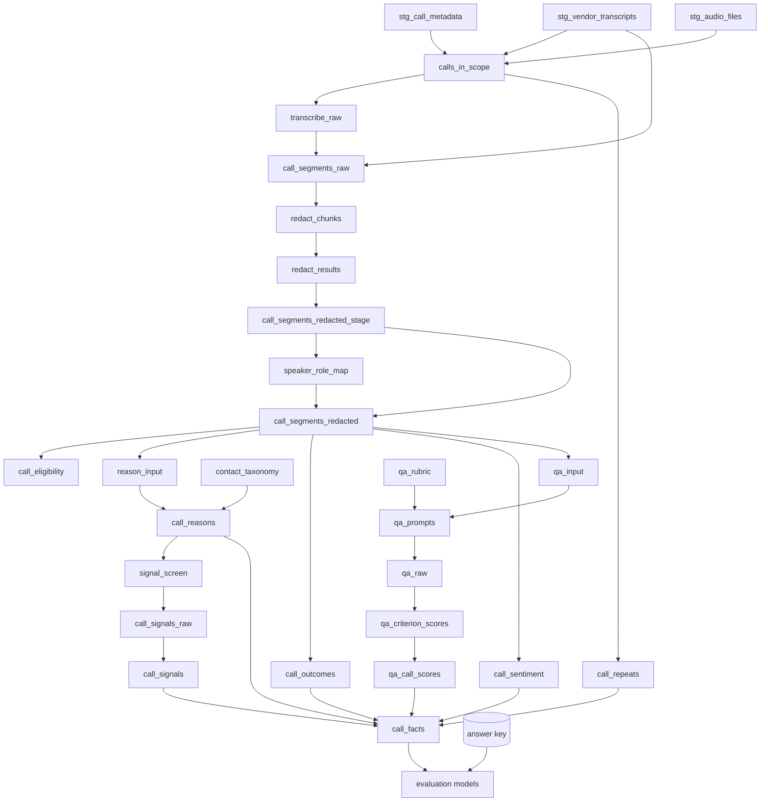

# Materializing the pipeline as a dbt project

The pipeline can be built as plain SQL or as a **dbt project deployed into Snowflake**. dbt is the better default
once past the first demo: version control on prompts, taxonomy and rubric; a real DAG; lineage from audio to agent;
and — the part that matters most for this play — dbt tests as **build-failing gates** on redaction leakage, QA
evidence, and parse failures.

**Delegate dbt mechanics.** This file covers which models exist and why each is materialized as it is. For
`snow dbt deploy`, `EXECUTE DBT PROJECT`, versioning, scheduling and CI, load **`dbt-projects-on-snowflake`**.

## Phase-to-model mapping

```
staging/        stg_call_metadata            view
                stg_vendor_transcripts       view
                stg_audio_files              view      (directory table of the audio stage)

intake/         calls_in_scope               table

transcribe/     transcribe_raw               incremental   AI_TRANSCRIBE; unique_key call_id
redact/         call_segments_raw            table (transient)
                redact_chunks                table (transient)
                redact_results               incremental   AI_REDACT; unique_key [call_id, seq, chunk_no]
                call_segments_redacted_stage table
roles/          speaker_role_map             incremental   AI_COMPLETE
                call_segments_redacted       table
                call_eligibility             view

reasons/        contact_taxonomy             seed (csv) or table
                reason_input                 table
                call_reasons                 incremental   AI_CLASSIFY
                call_repeats                 table
                call_outcomes                incremental   AI_EXTRACT
                call_sentiment               incremental   AI_SENTIMENT

qa/             qa_rubric                    seed (csv) or table
                qa_input, qa_prompts         table
                qa_raw                       incremental   AI_COMPLETE
                qa_criterion_scores          incremental
                qa_call_scores               incremental

signals/        signal_screen                incremental   AI_FILTER
                call_signals_raw             incremental   AI_EXTRACT
                call_signals                 incremental

marts/          call_facts                   table (or incremental merge on call_id)

evaluation/     eval_pii_leaks               incremental
                eval_reasons, eval_qa        incremental
                eval_summary                 incremental
```

The dynamic tables, semantic view, search service, and agent in Phase 7 sit outside dbt; create them with SQL after
`call_facts` exists, or as post-hooks if the team prefers one deploy unit.



## Materialization choices, and why

| Layer | Materialization | Reason |
|---|---|---|
| `staging` | `view` | renaming and typing only; no model calls |
| any model calling an AI function | `incremental` | a `view` or `table` would re-invoke and **re-bill** on every run. For AI_TRANSCRIBE this is the single most expensive mistake available in this play |
| intermediate SQL over model outputs | `table` | cheap to rebuild, keeps lineage simple |
| PII-bearing intermediates (`call_segments_raw`, `redact_chunks`) | `table` with `transient: true` | reconstructable; should not accumulate Time Travel history of raw PII |
| `evaluation` | `incremental` keyed on `run_id` | so experiments accumulate (best-practices O7) |

### Incremental config for model-calling layers

```sql
-- models/transcribe/transcribe_raw.sql
{{ config(
    materialized = 'incremental',
    unique_key = 'call_id',
    incremental_strategy = 'merge',
    on_schema_change = 'append_new_columns',
    pre_hook = "ALTER SESSION SET AI_SQL_ERROR_HANDLING_USE_FAIL_ON_ERROR = FALSE"
) }}

SELECT c.call_id, c.recording_path, c.timestamp_granularity,
       TRY_PARSE_JSON(TO_VARCHAR(r:value)) AS tx_value,
       r:error::STRING AS error,
       '{{ var("run_id") }}' AS run_id,
       CURRENT_TIMESTAMP() AS transcribed_at
FROM (
    SELECT c.*, AI_TRANSCRIBE(TO_FILE('@{{ var("audio_stage") }}', c.recording_path),
                              {'timestamp_granularity': 'speaker'}, TRUE) AS r
    FROM {{ ref('calls_in_scope') }} c
    WHERE c.source_route = 'AUDIO'
    
      AND c.call_id NOT IN (SELECT call_id FROM {{ this }} WHERE error IS NULL)
    
) c
```

The `pre_hook` matters for `redact_results` above all (best-practices R1); it is harmless on the others. Confirm
that a pre-hook session setting applies in your dbt-on-Snowflake execution context by running the redact model once
with a known-bad chunk.

The `is_incremental()` filter is what stops a re-run from transcribing the whole history again. Without it, every
`dbt run` re-bills every call.

## Project configuration

```yaml
# dbt_project.yml
name: call_center_intelligence
version: 1.0.0
profile: call_center_intelligence

vars:
  run_id: "manual"
  experiment_id: "exp_001"
  experiment_name: "baseline"
  prompt_version: "v1"
  taxonomy_version: "tax_v1"
  rubric_version: "rub_v1"
  audio_stage: "RAW.CALL_AUDIO_STAGE"
  min_call_seconds: 20
  repeat_window_days: 7
  redaction_enabled: true
  redact_chunk_target_tokens: 700
  qa_judge_model: "claude-sonnet-4-5"         # verify GA and region at preflight
  signal_reasoner_model: "claude-haiku-4-5"   # verify GA and region at preflight
  min_reason_macro_f1: 0.0
  max_redaction_leak_rate: 0.0
  min_qa_within_one: 0.0

models:
  call_center_intelligence:
    staging:    {+materialized: view}
    intake:     {+materialized: table}
    transcribe: {+materialized: incremental}
    redact:     {+materialized: table}
    roles:      {+materialized: table}
    reasons:    {+materialized: table}
    qa:         {+materialized: table}
    signals:    {+materialized: table}
    marts:      {+materialized: table}
    evaluation: {+materialized: incremental}
```

Override per model where the mapping above says `incremental`. Every run-identity var (`run_id`, `experiment_id`,
`prompt_version`, `taxonomy_version`, `rubric_version`) is **selected into** the model output, not only used to
filter.

`redaction_enabled: false` must be paired with the opt-out record in `callcenter-project.yml`; a CI check can assert
that the three opt-out keys exist whenever the var is false.

Seeds for taxonomy and rubric (`seeds/contact_taxonomy.csv`, `seeds/qa_rubric.csv`) put the label set and the rubric
under version control, which is exactly where a customer override belongs.

## dbt tests as quality gates

```yaml
# models/roles/schema.yml
version: 2
models:
  - name: call_segments_redacted
    columns:
      - name: redaction_status
        tests:
          - accepted_values: {values: ['REDACTED', 'FAILED', 'MISSING', 'OPTED_OUT']}
      - name: speaker_role
        tests:
          - accepted_values: {values: ['AGENT', 'CUSTOMER', 'IVR', 'UNKNOWN']}
  - name: qa_criterion_scores
    columns:
      - name: validation_status
        tests:
          - accepted_values: {values: ['OK', 'NO_EVIDENCE', 'BAD_CITATION', 'UNKNOWN_CRITERION']}
      - name: rubric_version
        tests: [not_null]
  - name: call_reasons
    columns:
      - name: taxonomy_version
        tests: [not_null]
```

Singular tests:

```sql
-- tests/assert_no_raw_fallback.sql
-- A segment that failed redaction must never carry text. A row here is a PII leak by construction.
SELECT call_id, seq
FROM {{ ref('call_segments_redacted') }}
WHERE redaction_status IN ('FAILED', 'MISSING') AND text_redacted IS NOT NULL
```

```sql
-- tests/assert_qa_scores_have_evidence.sql
SELECT call_id, criterion_id
FROM {{ ref('qa_criterion_scores') }}
WHERE applicable AND validation_status = 'OK'
  AND COALESCE(ARRAY_SIZE(evidence_seq), 0) = 0
```

```sql
-- tests/assert_no_model_on_unredacted_text.sql
-- Downstream inputs must come only from redacted segments.
SELECT r.call_id
FROM {{ ref('reason_input') }} r
JOIN {{ ref('call_eligibility') }} e ON e.call_id = r.call_id
WHERE NOT e.text_eligible
```

```sql
-- tests/assert_redaction_leak_under_threshold.sql   (sandbox and labeled-sample runs)
SELECT category, form, leak_rate
FROM (
  SELECT category, form, COUNT_IF(leaked) / NULLIF(COUNT(*), 0) AS leak_rate
  FROM {{ ref('eval_pii_leaks') }}
  WHERE run_id = '{{ var("run_id") }}'
  GROUP BY 1, 2
)
WHERE leak_rate > {{ var('max_redaction_leak_rate', 0.0) }}
```

```sql
-- tests/assert_reason_accuracy_not_regressed.sql
SELECT run_id, reason_macro_f1
FROM {{ ref('eval_summary') }}
WHERE run_id = '{{ var("run_id") }}'
  AND reason_macro_f1 < {{ var('min_reason_macro_f1', 0.0) }}
```

Set the accuracy thresholds to `0.0` for the first run, then raise to just under the achieved figure. The leak
threshold is set by the customer's privacy owner, not tuned.

## Platform gotchas

1. **Schema concatenation.** dbt writes to `<target_schema>_<custom_schema>` when `+schema` is set. Override
   `generate_schema_name`:

   ```sql
   -- macros/generate_schema_name.sql
   
       {{ custom_schema_name | trim if custom_schema_name else target.schema }}
   
   ```

2. **No `authenticator: externalbrowser`** in a profile used by dbt on Snowflake.
3. **Row-level error handling in every model-calling model** (`return_error_details`, `TRY_` forms, or the session
   parameter), so one bad row does not fail the model and everything downstream.
4. **Never commit a real `profiles.yml`**; ship a template. Never default the run role to `ACCOUNTADMIN`.
5. **`ARGS` on `EXECUTE DBT PROJECT` is a dbt CLI string**, not JSON:

   ```sql
   EXECUTE DBT PROJECT cci.pipeline.call_center_intelligence
     ARGS = 'run --select reasons+ --vars {"run_id": "r042", "experiment_id": "exp_003", "taxonomy_version": "tax_v2"}';
   ```

   Verify supported flags through `dbt-projects-on-snowflake`.
6. **Selective re-runs.** A taxonomy change should re-run `reasons+` only; a rubric change `qa+` only. Never `dbt run`
   the whole project to test a prompt change — it would re-check transcription and redaction (cheap if incremental
   filters are correct, catastrophic if not).

## Choosing plain SQL instead

Right for a time-boxed proof of value or a team without dbt. Record `materialization.mode: sql`; skills emit
`CREATE TABLE IF NOT EXISTS` plus guarded `INSERT` statements as written in each phase. What is given up: version
control on prompts, taxonomy and rubric, lineage, and the build-failing tests above. The singular tests can still be
run by hand at each gate; say plainly that nothing enforces them.
