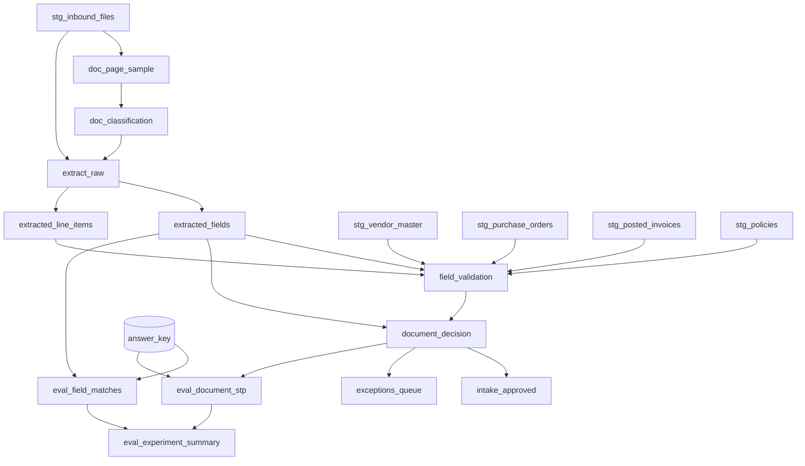

# Materializing the pipeline as a dbt project

The pipeline can be built as plain SQL or as a **dbt project deployed into Snowflake**. dbt is the
better default once the build is past first demo: the validation rules become build-failing tests, the
extraction schemas live in version control next to the models that consume them, and lineage shows a
downstream AP or claims team exactly which approved field came from which extraction run.

**Delegate the dbt mechanics.** This file covers what the models are and why each is materialized the
way it is. For `snow dbt deploy`, `EXECUTE DBT PROJECT`, versioning, scheduling, and CI, load the
**`dbt-projects-on-snowflake`** skill. Do not reproduce its guidance here.

## Phase-to-model mapping

```
staging/        stg_inbound_files            view          DIRECTORY(@stage) + manifest metadata
                stg_vendor_master            view
                stg_purchase_orders          view
                stg_policies                 view
                stg_posted_invoices          view

classify/       doc_page_sample              incremental   first-page parse, page_filter only
                doc_classification           incremental   AI_CLASSIFY + routing

extract/        extract_raw                  incremental   one AI_EXTRACT response per doc x schema_hash
                extracted_fields             incremental   one row per doc x field, normalized
                extracted_line_items         incremental   flattened table extraction

validate/       field_validation             incremental   one row per doc x rule
                document_decision            incremental   AUTO_APPROVED | EXCEPTION | REJECTED
                intake_approved              incremental   posts only from document_decision
                exceptions_queue             incremental   reviewer-facing, one row per doc

evaluate/       eval_field_matches           incremental
                eval_document_stp            incremental
                eval_experiment_summary      incremental
                eval_cost_per_1k_pages       table
```



## Materialization choices, and why

| Layer | Materialization | Reason |
|---|---|---|
| `staging` | `view` | Renaming and typing only. No AI calls. |
| `classify`, `extract` | `incremental` | These call `AI_PARSE_DOCUMENT`, `AI_CLASSIFY`, `AI_EXTRACT`. A `view` re-invokes and **re-bills every page** each time anything selects from it. A `table` re-processes the whole stage on every run. Incremental processes each file once per schema version. |
| `validate` | `incremental` | So each run's decisions are retained: an approved document must be traceable to the run, schema, and thresholds that approved it. |
| `evaluate` | `incremental` | So experiments accumulate and can be compared. |

### The incremental predicate is the cost control

```sql
-- models/extract/extract_raw.sql
{{ config(
    materialized = 'incremental',
    unique_key = ['document_id', 'schema_hash'],
    incremental_strategy = 'merge',
    on_schema_change = 'append_new_columns'
) }}



SELECT
    c.document_id,
    c.relative_path,
    c.document_type,
    '{{ var("run_id") }}'          AS run_id,
    '{{ var("experiment_id") }}'   AS experiment_id,
    '{{ var("schema_version") }}'  AS schema_version,
    SHA2(TO_JSON(PARSE_JSON('{{ tojson(schema_obj) }}')))  AS schema_hash,
    AI_EXTRACT(
        file           => TO_FILE('{{ var("stage_fqn") }}', c.relative_path),
        responseFormat => PARSE_JSON('{{ tojson(schema_obj) }}'),
        scores         => TRUE
    ) AS response,
    CURRENT_TIMESTAMP() AS extracted_at
FROM {{ ref('doc_classification') }} c
WHERE c.route = 'EXTRACT' AND c.document_type = 'invoice'

  -- Process each file once per schema. NOT "arrived since last run": arrival
  -- timestamps lie on re-upload, and a schema change must re-extract.
  AND NOT EXISTS (
      SELECT 1 FROM {{ this }} t
      WHERE t.document_id = c.document_id
        AND t.schema_hash = SHA2(TO_JSON(PARSE_JSON('{{ tojson(schema_obj) }}')))
  )

```

The same `PARSE_JSON('{{ tojson(schema_obj) }}')` expression feeds both the hash and the call, so the
hash describes the schema that actually ran.

Keep one model per document type for `extract_raw` (or one model with a `UNION ALL` per type), never a
single call with a `CASE` choosing the schema — `responseFormat` must be a constant-shaped object per
call, and a per-type model also makes per-type cost visible.

## Project configuration

```yaml
# dbt_project.yml
name: document_intake
version: 1.0.0
profile: document_intake

vars:
  run_id: "manual"
  experiment_id: "exp_001"
  experiment_name: "baseline schemas"
  schema_version: "v1"
  stage_fqn: "@DOC_INTAKE.RAW.INBOUND_DOCS"
  extract_scale_factor: 1.0
  amount_tolerance: 0.01
  # Extraction schemas live in vars (or a seeds/ or macros/ file) so a schema
  # change is a reviewed diff, not an edit buried in a model.
  invoice_schema: {}       # populated from extract-document-fields

models:
  document_intake:
    staging:   {+materialized: view}
    classify:  {+materialized: incremental}
    extract:   {+materialized: incremental}
    validate:  {+materialized: incremental}
    evaluate:  {+materialized: incremental}
```

Every run-identity var — `run_id`, `experiment_id`, `experiment_name`, `schema_version` — is
**selected into model output**, and `schema_hash` is computed in SQL.

## dbt tests as the quality gates

The correctness rules map onto tests that fail the build.

```yaml
# models/validate/schema.yml
version: 2
models:
  - name: document_decision
    columns:
      - name: document_id
        tests: [not_null]
      - name: decision
        tests:
          - not_null
          - accepted_values:
              values: ['AUTO_APPROVED', 'EXCEPTION', 'REJECTED']
  - name: exceptions_queue
    columns:
      - name: reason_count
        tests:
          - dbt_utils.accepted_range:
              min_value: 1        # an exception with no reason is not actionable
  - name: doc_classification
    columns:
      - name: document_type
        tests: [not_null]         # errors map to 'UNCLASSIFIED', never NULL
      - name: route
        tests:
          - accepted_values:
              values: ['EXTRACT', 'EXCEPTION', 'REJECT']
```

Singular tests for what a column test cannot express:

```sql
-- tests/assert_nothing_posts_without_auto_approval.sql
SELECT a.document_id
FROM {{ ref('intake_approved') }} a
LEFT JOIN {{ ref('document_decision') }} d
       ON d.document_id = a.document_id AND d.run_id = a.run_id
WHERE d.decision IS DISTINCT FROM 'AUTO_APPROVED'
```

```sql
-- tests/assert_no_null_scores_on_extracted_values.sql
-- Positional AI_EXTRACT returns no scoring object; this catches it.
SELECT document_id, field_name
FROM {{ ref('extracted_fields') }}
WHERE raw_value IS NOT NULL AND score IS NULL
```

```sql
-- tests/assert_no_bank_change_auto_approved.sql
-- A remittance account that differs from the vendor master must never post.
SELECT d.document_id
FROM {{ ref('document_decision') }} d
JOIN {{ ref('field_validation') }} v
  ON v.document_id = d.document_id AND v.run_id = d.run_id
WHERE d.decision = 'AUTO_APPROVED'
  AND v.rule_id = 'VENDOR_BANK_MATCH' AND v.passed = FALSE
```

```sql
-- tests/assert_false_stp_has_not_regressed.sql
-- Build-failing gate on the headline risk. Start max at the first measured
-- value and lower it as the pipeline improves; never raise it silently.
SELECT experiment_id, false_stp_rate
FROM {{ ref('eval_experiment_summary') }}
WHERE run_id = '{{ var("run_id") }}'
  AND false_stp_rate > {{ var('max_false_stp_rate', 1.0) }}
```

## Platform gotchas

1. **Schema concatenation.** A `+schema:` set alongside a target schema yields `<SCHEMA>_<SCHEMA>`.
   Override `generate_schema_name`:

   ```sql
   
       {{ custom_schema_name | trim if custom_schema_name else target.schema }}
   
   ```

2. **No `authenticator: externalbrowser`** in a profile used by dbt on Snowflake.
3. **Fully qualify the stage** in `TO_FILE`; the executing session's schema is not the one you expect.
4. **Never commit a real `profiles.yml`** and never default the role to `ACCOUNTADMIN`.
5. **`ARGS` on `EXECUTE DBT PROJECT` is a dbt CLI string**, not JSON. Verify supported flags via the
   `dbt-projects-on-snowflake` skill.
6. **`ACCOUNT_USAGE.DBT_PROJECT_EXECUTION_HISTORY`** for run observability; combine with
   `CORTEX_AI_FUNCTIONS_USAGE_HISTORY` filtered on `QUERY_TAG` for per-model AI cost.

## Choosing plain SQL instead

Right for a time-boxed POC or a team with no dbt practice. Record `materialization.mode: sql` and the
skills emit `CREATE TABLE IF NOT EXISTS` plus `MERGE` statements (never bare `CREATE OR REPLACE` on the
extraction and decision layers — that discards history and re-bills pages on the next run).

What is given up: versioned schemas, lineage, and build-failing tests. The same assertions still run as
verification queries at each gate, but nothing stops a later edit from skipping them.
