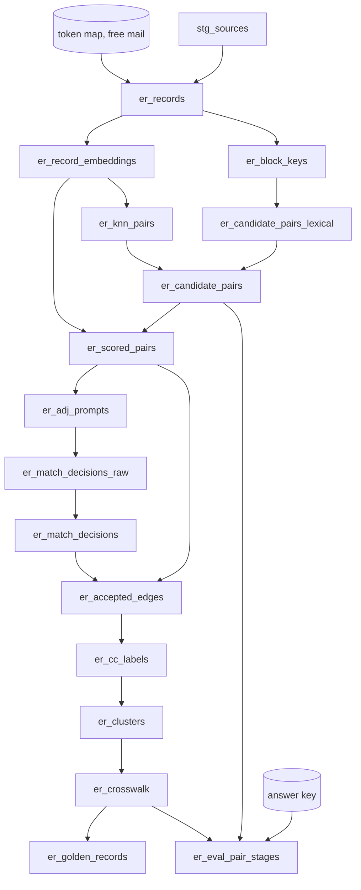

# Materializing the pipeline as a dbt project

The pipeline can be built as plain SQL (the templates under each skill's `sql/`) or as a **dbt project
deployed into Snowflake**. dbt is the better default once past first demo: version control on
normalization rules and thresholds, a real DAG, lineage from source tables to golden records, and —
most valuable here — dbt tests as **build-failing** gates on the failure modes in
`entity-resolution-best-practices`.

**Delegate the dbt mechanics.** For `snow dbt deploy`, `EXECUTE DBT PROJECT`, versioning, `env.yml`,
scheduling and CI, load the **`dbt-projects-on-snowflake`** skill. This file covers what the models are
and why each is materialized the way it is.

## Phase-to-model mapping

```
seeds/            er_token_map                seed
                  er_free_email_domains       seed
                  er_survivorship_rules       seed

staging/          stg_<source>                view     (one per configured source)
                  er_source_staging           view     (union of stg_*)

standardize/      er_records                  table
                  er_block_keys               table
                  er_block_stats              table
                  er_candidate_pairs_lexical  table

score/            er_record_embeddings        incremental   (AI_EMBED; unique_key record_uid+model+template)
                  er_knn_pairs                table
                  er_candidate_pairs          table         (lexical UNION knn)
                  er_scored_pairs             incremental   (unique_key run_id+pair_id)

adjudicate/       er_adj_prompts              incremental   (unique_key run_id+pair_id+presented_order)
                  er_match_decisions_raw      incremental   (AI_COMPLETE; same key)
                  er_match_decisions          incremental

golden/           er_accepted_edges           incremental
                  er_cc_labels                (run-operation macro; see below)
                  er_clusters                 incremental
                  er_golden_id_assignment     table
                  er_crosswalk                incremental   (unique_key run_id+record_uid)
                  er_golden_records           incremental   (unique_key run_id+golden_id)
                  er_entity_relationships     incremental

evaluation/       er_eval_true_pairs          table
                  er_eval_pair_stages         incremental
                  er_eval_summary             incremental
```



## Materialization choices, and why

| Layer | Materialization | Reason |
|---|---|---|
| seeds | `seed` | Token maps and survivorship rules are reviewed business configuration; version control on them is the point. |
| staging | `view` | Column mapping and filters only. |
| standardize | `table` | No AI, but every downstream model reads it many times; recomputing token normalization in a view would be wasteful. |
| `er_record_embeddings` | `incremental` | **Contains `AI_EMBED`.** A view or table rebuild re-embeds every record every run. Incremental on `(record_uid, embed_model, embed_template_version)` with an `is_incremental()` filter to rows whose text hash changed is the cost control. |
| `er_match_decisions_raw` | `incremental` | **Contains `AI_COMPLETE`.** Same reasoning; plus the prompt-hash reuse (adjudicate section 3a) belongs in this model's SQL. |
| scored, decisions, golden, evaluation | `incremental` | So experiments **accumulate** (rule 34). |

### The embedding model

```sql
{{ config(
    materialized = 'incremental',
    unique_key = ['record_uid', 'embed_model', 'embed_template_version'],
    incremental_strategy = 'merge',
    on_schema_change = 'fail'
) }}

SELECT r.record_uid, r.entity_type,
       '{{ var("embed_model") }}'      AS embed_model,
       '{{ var("embed_template") }}'   AS embed_template_version,
       r.embed_text_hash,
       AI_EMBED('{{ var("embed_model") }}', r.embed_text)::VECTOR(FLOAT, {{ var("embed_dim") }}) AS embedding,
       CURRENT_TIMESTAMP() AS embedded_at
FROM {{ ref('er_records') }} r

WHERE NOT EXISTS (
    SELECT 1 FROM {{ this }} e
    WHERE e.record_uid = r.record_uid
      AND e.embed_model = '{{ var("embed_model") }}'
      AND e.embed_template_version = '{{ var("embed_template") }}'
      AND e.embed_text_hash = r.embed_text_hash)

```

`on_schema_change = 'fail'` is deliberate: a changed vector dimension must stop the build, not append a
column.

### Connected components

Label propagation is iterative, which a single dbt model cannot express. Implement it as a macro
invoked with `run-operation` (or as a post-hook on `er_accepted_edges`) that runs the loop from
`build-golden-records/sql/01_cluster_and_survive.sql` section 2 against regular tables, then let
`er_clusters` select from the result. Do not use a recursive CTE model (see that skill for why).

## Project configuration

```yaml
# dbt_project.yml
name: entity_resolution
version: 1.0.0
profile: entity_resolution

vars:
  run_id: "manual"
  experiment_id: "exp_001"
  experiment_name: "baseline"
  prompt_version: "v1"
  prior_run_id: "none"
  # Pinned at preflight. Verify GA and region before changing.
  embed_model: "snowflake-arctic-embed-l-v2.0"
  embed_dim: 1024
  embed_template: "t1"
  adjudicate_model: "claude-sonnet-4-5"
  # Calibrated in evaluate-match-accuracy; bump experiment_id when changing.
  auto_match: 0.92
  auto_reject: 0.55
  model_accept_confidence: 0.70
  max_block_size: 200
  max_cluster_size: 25
  min_cluster_cohesion: 0.60
  min_acceptable_pairwise_precision: 0.0
  min_acceptable_bcubed_f1: 0.0

models:
  entity_resolution:
    staging:     { +materialized: view }
    standardize: { +materialized: table }
    score:       { +materialized: incremental }
    adjudicate:  { +materialized: incremental }
    golden:      { +materialized: incremental }
    evaluation:  { +materialized: incremental }
```

Every run-identity var is **selected into** model output, not just used for filtering.

## dbt tests as quality gates

```yaml
# models/standardize/schema.yml
version: 2
models:
  - name: er_records
    columns:
      - name: record_uid
        tests: [unique, not_null]                  # rule 4
      - name: embed_text
        tests: [not_null]                          # rule 1
  - name: er_candidate_pairs
    tests:
      - dbt_utils.expression_is_true:
          expression: "record_uid_a < record_uid_b"   # rule 9: order and no self-pairs
      - dbt_utils.unique_combination_of_columns:
          combination_of_columns: [record_uid_a, record_uid_b]
```

```yaml
# models/score/schema.yml
models:
  - name: er_scored_pairs
    columns:
      - name: band
        tests:
          - not_null                               # rule 18
          - accepted_values: { values: ['AUTO_MATCH', 'REVIEW', 'AUTO_REJECT'] }
```

Singular tests for what column tests cannot express:

```sql
-- tests/assert_no_auto_match_with_cannot_link.sql   (rule 16)
SELECT pair_id FROM {{ ref('er_scored_pairs') }}
WHERE run_id = '{{ var("run_id") }}' AND band = 'AUTO_MATCH' AND cannot_link
```

```sql
-- tests/assert_no_cannot_link_inside_publishable_cluster.sql   (rule 24)
SELECT cluster_key FROM {{ ref('er_clusters') }}
WHERE run_id = '{{ var("run_id") }}' AND cluster_status = 'PUBLISHABLE'
  AND ((entity_type <> 'PRODUCT' AND distinct_tax_ids > 1)
    OR (entity_type =  'PRODUCT' AND (distinct_gtins > 1 OR distinct_sizes > 1)))
```

```sql
-- tests/assert_crosswalk_complete.sql   (rule 27)
SELECT r.record_uid FROM {{ ref('er_records') }} r
LEFT JOIN {{ ref('er_crosswalk') }} x
  ON x.record_uid = r.record_uid AND x.run_id = '{{ var("run_id") }}'
GROUP BY r.record_uid
HAVING COUNT(x.record_uid) <> 1
```

```sql
-- tests/assert_model_matches_have_reasons.sql   (rule 21)
SELECT pair_id FROM {{ ref('er_match_decisions') }}
WHERE run_id = '{{ var("run_id") }}' AND outcome = 'MODEL_MATCH'
  AND (reason_count = 0 OR invalid_reason_count > 0)
```

```sql
-- tests/assert_golden_values_from_members.sql   (rule 25)
SELECT g.golden_id, f.key
FROM {{ ref('er_golden_records') }} g, LATERAL FLATTEN(input => g.attribute_provenance) f
WHERE g.run_id = '{{ var("run_id") }}'
  AND NOT EXISTS (SELECT 1 FROM {{ ref('er_crosswalk') }} x
                  WHERE x.run_id = g.run_id AND x.golden_id = g.golden_id
                    AND x.record_uid = f.value:record_uid::STRING)
```

```sql
-- tests/assert_accuracy_has_not_regressed.sql   (sandbox / labeled data)
SELECT entity_type FROM {{ ref('er_eval_summary') }}
WHERE run_id = '{{ var("run_id") }}'
  AND (pairwise_precision < {{ var('min_acceptable_pairwise_precision') }}
    OR bcubed_f1 < {{ var('min_acceptable_bcubed_f1') }})
```

Set the regression floors to `0.0` on the first run, then raise them to just under the achieved
figures.

## Platform gotchas

1. **dbt concatenates schemas** (`<SCHEMA>_<CUSTOM>`) when `+schema` is set. Override
   `generate_schema_name`. The answer key lives in a separate schema on purpose; make sure the override
   does not collapse it into the pipeline schema.
2. **Do not set `authenticator: externalbrowser`** in a profile used by native dbt on Snowflake.
3. **Never commit a real `profiles.yml`**, and never default the role to `ACCOUNTADMIN`. A least-privilege
   run role is also what keeps the vendor bank fields unreadable by the pipeline at all.
4. **`ARGS` on `EXECUTE DBT PROJECT` is a dbt CLI string**, not JSON, for example
   `ARGS = 'run --vars {"run_id": "r042", "experiment_id": "exp_003"}'`. Verify supported flags with the
   `dbt-projects-on-snowflake` skill.
5. **`AI_COMPLETE` now returns NULL for a failed row** rather than failing the statement (per its error
   behavior section), so one bad row does not fail the model — which also means failures are silent
   unless the decisions model counts them. The schema tests above are what make them loud.

## Choosing plain SQL instead

Plain SQL is right for a time-boxed proof of value or a team without a dbt practice. Record
`materialization.mode: sql`; the templates under each skill are the plain-SQL implementation. What is
given up: version control on token maps and thresholds, lineage, and the tests-as-gates above. Run the
gate verification queries in each skill by hand instead, and say plainly that nothing will stop a
regressed run except someone reading them.
