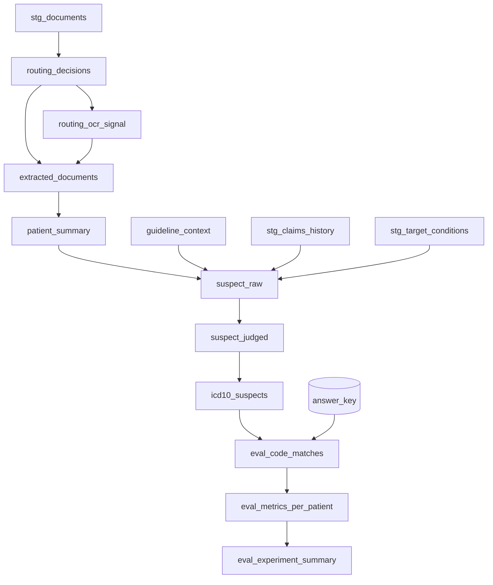

# Materializing the pipeline as a dbt project

The pipeline can be built as plain SQL or as a **dbt project deployed into Snowflake**. dbt is the
better default once the build is past first demo, because the LLMOps story — version control, a real
DAG, lineage, reproducible experiment runs, CI — is most of what makes this maintainable rather than a
one-off script.

**Delegate the dbt mechanics.** This file covers *what the models are and why they are materialized the
way they are*. For `snow dbt deploy`, `EXECUTE DBT PROJECT`, project-object versioning, `env.yml`,
scheduling, and CI, load the **`dbt-projects-on-snowflake`** skill — it owns that lifecycle and is kept
current. Do not reproduce its guidance here.

## Phase-to-model mapping

```
staging/          stg_documents               view
                  stg_claims_history          view
                  stg_target_conditions       view

routing/          routing_decisions           table
                  routing_ocr_signal          table

knowledge/        guideline_context           table

extraction/       extracted_documents         table
                  patient_summary             table

suspecting/       suspect_raw                 incremental
                  suspect_judged              incremental
                  icd10_suspects              incremental

evaluation/       eval_code_matches           incremental
                  eval_metrics_per_patient    incremental
                  eval_experiment_summary     incremental
```



## Materialization choices, and why each one

| Layer | Materialization | Reason |
|---|---|---|
| `staging` | `view` | Pure renaming and type coercion. Nothing to cache; a view keeps storage at zero and always reflects the source. |
| `routing`, `knowledge`, `extraction` | `table` | These contain AI function calls. A view would **re-invoke and re-bill inference every time anything downstream selects from it.** This is the single most important materialization decision in the project. |
| `suspecting`, `evaluation` | `incremental` | So experiment runs **accumulate** rather than replacing each other. See below. |

### Incremental on suspecting and evaluation is not optional

A `table` materialization drops and recreates on every run. If the eval models are tables, then stamping
`experiment_id` on every row is pointless — only one experiment can exist at rest, `GROUP BY
experiment_id` always returns one group, and any UI promising side-by-side comparison silently shows a
single run.

This is a real trap and it is easy to miss, because everything appears to work: the column is there, the
value is correct, and the comparison query runs without error against one row.

```sql
{{ config(
    materialized = 'incremental',
    unique_key = ['run_id', 'patient_id', 'hcc_code'],
    incremental_strategy = 'merge',
    on_schema_change = 'append_new_columns'
) }}

SELECT ...
FROM {{ ref('suspect_judged') }}

  -- Only process the current run. Without this the frontier-model fan-out
  -- re-runs over every historical patient on every invocation.
  WHERE run_id = '{{ var("run_id") }}'

```

`unique_key` includes `run_id`, so re-running the same experiment merges in place and is idempotent,
while a new `experiment_id` accumulates alongside the old.

## Project configuration

```yaml
# dbt_project.yml
name: icd10_suspecting
version: 1.0.0
profile: icd10_suspecting

vars:
  # Experiment identity. Overridden per run so results are attributable.
  run_id: "manual"
  experiment_id: "exp_001"
  experiment_name: "baseline"
  prompt_version: "v1"
  # Models, pinned per stage. Verify GA and region availability at preflight.
  classify_model: "llama3.1-8b"
  compress_model: "claude-haiku-4-5"
  extract_model: "claude-sonnet-4-6"
  judge_model: "claude-sonnet-4-5"
  # Risk model year. Unpinned means wrong revenue figures after a rollover.
  cms_model_year: "v28"
  # Confidence banding.
  high_confidence: 8
  review_candidate: 6

models:
  icd10_suspecting:
    staging:
      +materialized: view
    routing:
      +materialized: table
    knowledge:
      +materialized: table
    extraction:
      +materialized: table
    suspecting:
      +materialized: incremental
    evaluation:
      +materialized: incremental
```

Every var that identifies a run — `run_id`, `experiment_id`, `experiment_name`, `prompt_version` — must
be **selected into the model output**, not merely used for filtering:

```sql
SELECT
    '{{ var("run_id") }}'          AS run_id,
    '{{ var("experiment_id") }}'   AS experiment_id,
    '{{ var("experiment_name") }}' AS experiment_name,
    '{{ var("prompt_version") }}'  AS prompt_version,
    '{{ var("extract_model") }}'   AS model_used,
    ...
```

A result row that cannot say which prompt version and model produced it is not a reproducible result.

### Sources

```yaml
# models/sources.yml
version: 2
sources:
  - name: clinical
    database: "{{ var('source_database') }}"
    schema: "{{ var('source_schema') }}"
    tables:
      - name: clinical_documents
        description: "Source clinical documents. Assumed already landed."
        columns:
          - name: document_id
            tests: [unique, not_null]
          - name: patient_id
            tests: [not_null]
      - name: claims_history
        description: "Already-coded conditions, for gap suppression."
      - name: condition_reference
        description: "Target conditions with ICD-10 sets and RAF factors, pinned to a model year."
```

## Use dbt tests as real quality gates

This is where dbt earns its place over plain SQL, and it is the part most often declared in config and
never actually written. The plugin's correctness rules map directly onto tests that **fail the build**:

```yaml
# models/suspecting/schema.yml
version: 2
models:
  - name: icd10_suspects
    columns:
      - name: suspect_id
        tests: [unique, not_null]
      - name: coder_confidence
        tests:
          - not_null                      # enforces the in-pipeline scoring guarantee
          - accepted_values:
              values: [1,2,3,4,5,6,7,8,9,10]
      - name: judge_score
        tests: [not_null]
      - name: classification
        tests:
          - accepted_values:
              values: ['SUSPECT', 'EVAL']
      - name: evidence_count
        tests:
          - dbt_utils.accepted_range:
              min_value: 1                # no evidence, no suspect
      - name: model_year
        tests: [not_null]
```

Plus singular tests for the assertions a column test cannot express:

```sql
-- tests/assert_evidence_is_traceable.sql
-- Every cited document_id must resolve. A failing row here means an
-- unauditable suspect, which is a correctness failure, not a warning.
SELECT s.suspect_id, f.value:document_id::STRING AS cited_doc
FROM {{ ref('icd10_suspects') }} s,
     LATERAL FLATTEN(input => s.evidence) f
WHERE f.value:document_id::STRING NOT IN (
    SELECT document_id FROM {{ ref('extracted_documents') }}
)
```

```sql
-- tests/assert_no_unrouted_documents.sql
-- Nothing may sit in an OCR tier without a file to OCR: those documents
-- produce nothing and vanish silently.
SELECT document_id, assigned_tier
FROM {{ ref('routing_decisions') }}
WHERE assigned_tier IS NULL
   OR (assigned_tier IN ('T1','T3') AND file_path IS NULL)
```

```sql
-- tests/assert_accuracy_has_not_regressed.sql
-- A build-failing regression gate. Without this, accuracy can degrade run
-- over run and nothing tells you.
SELECT experiment_id, micro_f1
FROM {{ ref('eval_experiment_summary') }}
WHERE run_id = '{{ var("run_id") }}'
  AND micro_f1 < {{ var('min_acceptable_f1', 0.0) }}
```

Set `min_acceptable_f1` to `0.0` on the first run, then raise it to just under the achieved figure so
future regressions break the build rather than passing quietly.

## Platform gotchas

Each of these costs hours to rediscover.

1. **dbt writes to `<DATABASE>.<SCHEMA>_<SCHEMA>`** by default when a `+schema:` is set alongside a
   profile target schema — dbt *concatenates* rather than replacing. Override
   `generate_schema_name` rather than hardcoding the doubled name downstream:

   ```sql
   -- macros/generate_schema_name.sql
   
       {{ custom_schema_name | trim if custom_schema_name else target.schema }}
   
   ```

2. **Do not set `authenticator: externalbrowser`** in a profile used by native dbt on Snowflake. It
   triggers a `SHOW PARAMETER` error, and the connection is already established by the executing
   session.

3. **Use `TRY_COMPLETE`, not `COMPLETE`, in any model that calls a model over a table.** One row that
   errors — context overflow, a guardrail trip — otherwise fails the whole model and every model
   downstream of it. In a batch of thousands, one bad row should not cost the run.

4. **Never commit a real `profiles.yml`.** Ship `profiles.yml.template` and gitignore the real one. And
   never default the role to `ACCOUNTADMIN`: a dbt run role should be least-privilege, and in a
   healthcare deployment it is a finding rather than a nit.

5. **`ARGS` on `EXECUTE DBT PROJECT` is a dbt CLI string**, not JSON:

   ```sql
   -- Correct
   EXECUTE DBT PROJECT db.schema.icd10_suspecting_project
     ARGS = 'run --target prod --vars {"run_id": "r042", "experiment_id": "exp_003"}';
   ```

   Verify the flags you rely on against the supported-commands page via the
   `dbt-projects-on-snowflake` skill — the supported subset is narrower than dbt Core's.

6. **`ACCOUNT_USAGE.DBT_PROJECT_EXECUTION_HISTORY`** gives per-run observability including which
   environment was used. Prefer it over parsing logs.

## Choosing plain SQL instead

Plain SQL is the right call when the customer has no dbt practice, the build is a time-boxed
proof of value, or the pipeline will be owned by a team that does not use dbt. Record
`materialization.mode: sql` in `icd10-project.yml` and the skills emit `CREATE OR REPLACE TABLE`
statements instead.

What is given up: version control on the transformations, lineage, and — most significantly — the
test-as-quality-gate mechanism above. Say that plainly rather than presenting the two paths as
equivalent.
