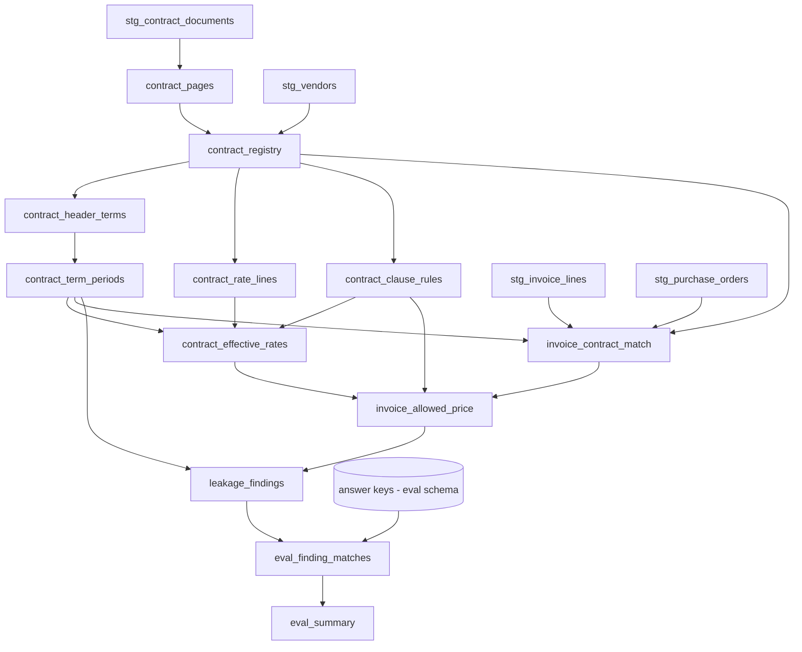

# Materializing the pipeline as a dbt project

The pipeline can be built as plain SQL or as a **dbt project deployed into Snowflake**. dbt is the
better default once the build outlives its first readout, because the parts of this play that fail
silently — a finding with no clause evidence, a total summed across currencies, a rate applied
outside its effective window — become **dbt tests that fail the build** instead of numbers somebody
notices are wrong after a supplier conversation.

**Delegate the dbt mechanics.** This file covers *what the models are and why they are materialized
the way they are*. For `snow dbt deploy`, `EXECUTE DBT PROJECT`, project-object versioning, scheduling
and CI, load the **`dbt-projects-on-snowflake`** skill. Do not reproduce its guidance here.

## Phase-to-model mapping

```
staging/          stg_contract_documents      view
                  stg_vendors                 view
                  stg_purchase_orders         view
                  stg_invoice_lines           view

parse/            contract_pages              incremental   (AI_PARSE_DOCUMENT)
                  contract_registry           table         (AI_EXTRACT identity, AI_CLASSIFY)

extract/          contract_header_terms       incremental   (AI_EXTRACT)
                  contract_rate_lines         incremental   (AI_EXTRACT table)
                  contract_clause_rules       incremental   (AI_COMPLETE)
                  contract_term_periods       table         (pure SQL)
                  contract_effective_rates    table         (pure SQL)

reconcile/        invoice_contract_match      table         (AI_SIMILARITY fallback only)
                  invoice_allowed_price       table
                  leakage_findings            incremental
                  reconcile_exceptions        incremental

evaluation/       eval_doc_results            incremental
                  eval_term_results           incremental
                  eval_rate_results           incremental
                  eval_finding_matches        incremental
                  eval_dollar_reconciliation  incremental
                  eval_summary                incremental
```



## Materialization choices, and why each one

| Layer | Materialization | Reason |
|---|---|---|
| `staging` | `view` | Column renaming and type coercion onto the canonical names every later model uses. No inference. |
| `contract_pages` | `incremental`, `unique_key = ['document_id','page_index']` | `AI_PARSE_DOCUMENT` bills per page. A `table` reparses every contract on every run; a `view` reparses on every downstream select. Incremental on a document's content hash is the only acceptable shape. |
| `contract_registry` | `table` | Small (one row per document), and the duplicate and family logic is set-based across all documents, so it must see the whole population each run. Its AI calls are cached by joining to the previous run's registry on `norm_text_hash` (see below). |
| `contract_header_terms`, `contract_rate_lines`, `contract_clause_rules` | `incremental` | Accumulate across `experiment_id` so prompt changes compare side by side. |
| `contract_term_periods`, `contract_effective_rates` | `table` | Pure SQL derived from the current experiment's terms; recomputed in full, which is cheap. |
| `invoice_contract_match`, `invoice_allowed_price` | `table` | Pure SQL apart from the `AI_SIMILARITY` description fallback, which runs only on lines with no SKU match. Recomputed in full so a corrected term reprices every historical line. |
| `leakage_findings`, `reconcile_exceptions`, `eval_*` | `incremental` | Accumulate by `run_id` so an experiment's findings stay comparable, and so `review_status` set by analysts is never overwritten by a rebuild. |

### Never re-bill a parse

The single most expensive mistake available in this project is a parse model that reprocesses
unchanged contracts. Key the incremental on content, not on file name, because CLMs re-upload the
same PDF under a new name constantly:

```sql
{{ config(
    materialized = 'incremental',
    unique_key = ['document_id', 'page_index'],
    incremental_strategy = 'merge'
) }}

WITH src AS (
    SELECT d.document_id, d.file_path, d.content_md5
    FROM {{ ref('stg_contract_documents') }} d
    
    WHERE NOT EXISTS (
        SELECT 1 FROM {{ this }} p
        WHERE p.document_id = d.document_id
          AND p.content_md5 = d.content_md5)
    
)
SELECT ...
```

`content_md5` comes from the stage directory table (`DIRECTORY(@stage)` exposes `MD5`) for files and
from `MD5(document_text)` for text-native rows.

### Findings must not be rebuilt over reviewer decisions

`leakage_findings` carries `review_status`, `reviewed_by` and `reviewed_at`, defaulted to `NEW`, NULL,
NULL. If the model is a `table`, every rebuild resets analyst decisions and a finding the supplier
already credited reappears as new. Use `merge` with `merge_update_columns` that exclude the review
columns:

```sql
{{ config(
    materialized = 'incremental',
    unique_key = ['run_id', 'finding_id'],
    incremental_strategy = 'merge',
    merge_update_columns = ['impact_amount','evidence','arithmetic','prompt_hash']
) }}
```

`finding_id` is a deterministic hash of `finding_type`, `contract_family_id` and `invoice_line_id`
(or `term_period_end` for renewal findings), so the same leakage found by two runs has the same id.

## Project configuration

```yaml
# dbt_project.yml
name: spend_leakage
version: 1.0.0
profile: spend_leakage

vars:
  run_id: "manual"
  experiment_id: "exp_001"
  experiment_name: "baseline"
  prompt_version: "v1"
  as_of_date: "2026-09-30"          # REQUIRED; never default to current_date
  clause_model: "claude-sonnet-4-6" # verify GA and region at preflight
  price_tolerance_abs: 0.05
  price_tolerance_rel_pct: 0.5
  renewal_horizon_days: 90
  exposure_window_months: 12
  sku_similarity_min: 0.80
  sku_similarity_margin: 0.03
  vendor_name_jw_min: 92
  query_tag_prefix: "spend_leakage"

models:
  spend_leakage:
    staging:   { +materialized: view }
    parse:     { +materialized: table, +query_tag: "spend_leakage:parse" }
    extract:   { +materialized: incremental, +query_tag: "spend_leakage:extract" }
    reconcile: { +materialized: table, +query_tag: "spend_leakage:reconcile" }
    evaluation:
      +materialized: incremental
      +schema: eval                  # answer keys and eval models never share the pipeline schema
```

The `query_tag` per layer is what lets `evaluate-leakage-accuracy` attribute AI function credits to a
phase from `SNOWFLAKE.ACCOUNT_USAGE.CORTEX_AI_FUNCTIONS_USAGE_HISTORY`. Append the run id in a
`pre_hook` (`ALTER SESSION SET QUERY_TAG = '{{ var("query_tag_prefix") }}:{{ this.name }}:{{ var("run_id") }}'`)
so cost resolves to a run, not just a phase.

## Tests that encode the correctness rules

These are the reason to choose dbt. Each maps to a rule in `spend-leakage-best-practices`.

```yaml
# models/reconcile/schema.yml
models:
  - name: leakage_findings
    columns:
      - name: finding_id
        tests: [not_null]
      - name: impact_currency
        tests: [not_null]
      - name: impact_kind
        tests:
          - accepted_values:
              values: [RECOVERABLE_OVERCHARGE, SPEND_UNDER_MANAGEMENT, COMMITMENT_EXPOSURE]
      - name: evidence
        tests: [not_null]
    tests:
      # Rule 2: no finding may rely on a term whose quote failed verification.
      - dbt_utils.expression_is_true:
          expression: "NOT ARRAY_CONTAINS('UNVERIFIED'::VARIANT, evidence_term_statuses)"
      # Rule 9: one finding per line per type, so duplicates cannot double the total.
      - dbt_utils.unique_combination_of_columns:
          combination_of_columns: [run_id, finding_type, invoice_line_id, contract_family_id]
      # Rule 6: line-grain overcharge cannot exceed the line amount.
      - dbt_utils.expression_is_true:
          expression: "impact_kind <> 'RECOVERABLE_OVERCHARGE' OR impact_amount <= line_amount + 0.01"

  - name: contract_effective_rates
    tests:
      # Rule 4: effective windows for one (family, sku, tier) never overlap.
      - no_overlapping_windows:
          partition_by: [contract_family_id, sku, tier_min_qty]
          start_col: effective_from
          end_col: effective_to

  - name: contract_registry
    tests:
      # Rule 3: a duplicate never governs a family.
      - dbt_utils.expression_is_true:
          expression: "NOT (is_duplicate_of IS NOT NULL AND family_role = 'GOVERNING')"
```

`no_overlapping_windows` is a small generic test in `tests/generic/`:

```sql

SELECT a.*
FROM {{ model }} a
JOIN {{ model }} b
  ON  a.{{ c }} IS NOT DISTINCT FROM b.{{ c }} AND 
     a.rate_line_id < b.rate_line_id
 AND a.{{ start_col }} <= b.{{ end_col }}
 AND b.{{ start_col }} <= a.{{ end_col }}

```

The accuracy gates from `evaluate-leakage-accuracy` (`min_finding_precision`, `min_finding_recall`,
`max_dollar_abs_error_pct`) become singular tests on `eval_summary` for sandbox runs only. They have
no meaning on customer data without a labeled sample, and must be disabled there rather than passing
vacuously against an empty key.

## What stays outside dbt

- **Stage and directory table creation**, which the corpus skill owns.
- **The answer keys.** They are seeded by `seed-spend-leakage-sandbox` into the eval schema and are
  declared as dbt `sources` only in the evaluation models. Nothing under `parse/`, `extract/` or
  `reconcile/` may `ref` or `source` them; enforce this with a CI grep for the eval schema name.
- **The semantic view and agent.** Created by `operationalize-leakage-pipeline` after the dbt run, as
  post-deploy DDL, so a failed dbt run cannot leave the agent pointing at half-built tables.
