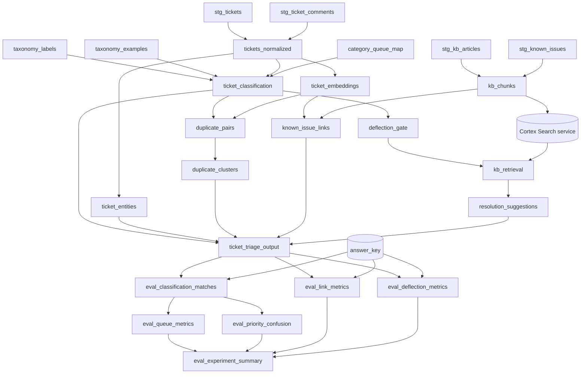

# Materializing the pipeline as a dbt project

The pipeline can be built as plain SQL or as a **dbt project deployed into Snowflake**. dbt is the
better default once the build is past first demo: label sets and prompts under version control, a
real DAG, lineage from a suggested resolution back to the KB chunk it cites, reproducible experiment
runs, and tests that fail the build.

**Delegate the dbt mechanics.** This file covers *what the models are and why they are materialized
the way they are*. For `snow dbt deploy`, `EXECUTE DBT PROJECT`, project-object versioning,
scheduling and CI, load the **`dbt-projects-on-snowflake`** skill — it owns that lifecycle and is
kept current. Do not reproduce its guidance here.

## Phase-to-model mapping

```
staging/          stg_tickets                    view
                  stg_ticket_comments            view
                  stg_kb_articles                view
                  stg_known_issues               view

taxonomy/         taxonomy_labels                seed (CSV) or table
                  taxonomy_examples              seed (CSV) or table
                  category_queue_map             seed (CSV) or table

normalize/        tickets_normalized             incremental (unique_key ticket_id)

knowledge/        kb_chunks                      table
                  (Cortex Search service)        post-hook or separate SQL, see below

classify/         ticket_classification          incremental
                  ticket_entities                incremental

link/             ticket_embeddings              incremental (unique_key ticket_id, embed_model)
                  duplicate_pairs                incremental
                  duplicate_clusters             incremental
                  known_issue_links              incremental

suggest/          deflection_gate                incremental
                  kb_retrieval                   incremental
                  resolution_suggestions         incremental

output/           ticket_triage_output           incremental

evaluation/       eval_classification_matches    incremental
                  eval_queue_metrics             incremental
                  eval_priority_confusion        incremental
                  eval_link_metrics              incremental
                  eval_deflection_metrics        incremental
                  eval_experiment_summary        incremental
```



## Materialization choices, and why each one

| Layer | Materialization | Reason |
|---|---|---|
| `staging` | `view` | Pure renaming and type coercion. Nothing to cache. |
| `taxonomy` | `seed` or `table` | Label sets are reviewed artefacts. As dbt seeds they are diffed in pull requests, which is exactly the review a taxonomy change needs. |
| `normalize` | `incremental` on `ticket_id` | May call `AI_REDACT`. A view would re-invoke and re-bill it every time anything selects downstream. |
| `knowledge` | `table` | Chunking is deterministic; the Cortex Search service reads from this table. |
| `classify`, `link`, `suggest`, `output` | `incremental` | These contain AI function calls (re-billed on every select if a view), and runs must **accumulate** by `run_id` for experiment comparison. |
| `evaluation` | `incremental` | So experiments accumulate side by side rather than replacing each other. |

**Never a view over an AI function.** This is the single most expensive mistake available here: a
semantic view, a BI dashboard and a Cortex Agent all select from the output repeatedly, and if any
layer between them and the source is a view containing `AI_CLASSIFY` or `AI_COMPLETE`, every
dashboard refresh re-classifies the corpus.

### Incremental is not optional on classify, suggest and evaluation

A `table` materialization drops and recreates on every run. Only one experiment then exists at rest,
`GROUP BY experiment_id` returns one group, and a comparison of "with descriptions" against "without
descriptions" silently shows one run. Everything appears to work.

```sql
{{ config(
    materialized = 'incremental',
    unique_key = ['run_id', 'ticket_id'],
    incremental_strategy = 'merge',
    on_schema_change = 'append_new_columns'
) }}

SELECT
    '{{ var("run_id") }}'            AS run_id,
    '{{ var("experiment_id") }}'     AS experiment_id,
    '{{ var("experiment_name") }}'   AS experiment_name,
    '{{ var("prompt_version") }}'    AS prompt_version,
    '{{ var("taxonomy_version") }}'  AS taxonomy_version,
    ...
FROM {{ ref('tickets_normalized') }} t

  -- Only tickets not yet classified in THIS run. Without this the
  -- classifier re-runs over every historical ticket on every invocation.
  WHERE NOT EXISTS (
      SELECT 1 FROM {{ this }} c
      WHERE c.run_id = '{{ var("run_id") }}' AND c.ticket_id = t.ticket_id)

```

For production (as opposed to experiment) runs, `operationalize-triage-pipeline` uses a fixed
`run_id` per production model version so new tickets append under one identity and a model change is
a deliberate new `run_id`.

### The Cortex Search service is not a dbt model

dbt has no native materialization for a Cortex Search service. Create it with a separate SQL step
(owned by `build-resolution-knowledge-store`) that reads from the `kb_chunks` table, and let the
service's own `TARGET_LAG` keep it fresh. Do not recreate the service in a dbt `post-hook` on every
run: `CREATE OR REPLACE CORTEX SEARCH SERVICE` triggers a full index build each time.

## Project configuration

```yaml
# dbt_project.yml
name: ticket_triage
version: 1.0.0
profile: ticket_triage

vars:
  run_id: "manual"
  experiment_id: "exp_001"
  experiment_name: "baseline"
  prompt_version: "v1"
  taxonomy_version: "tx_v1"
  # Models, pinned per stage. Verify GA and region availability at preflight.
  classify_fallback_model: ""
  suggest_model: ""
  embed_model: "snowflake-arctic-embed-l-v2.0"
  # Thresholds, tuned in evaluation.
  classify_confidence_floor: "MEDIUM"
  duplicate_similarity: 0.0
  known_issue_similarity: 0.0
  search_service: ""

models:
  ticket_triage:
    staging:   {+materialized: view}
    taxonomy:  {+materialized: table}
    normalize: {+materialized: incremental}
    knowledge: {+materialized: table}
    classify:  {+materialized: incremental}
    link:      {+materialized: incremental}
    suggest:   {+materialized: incremental}
    output:    {+materialized: incremental}
    evaluation: {+materialized: incremental}
```

Leave model vars empty rather than shipping a model name: preflight fills them after checking
`SHOW CORTEX BASE MODELS`. An empty string fails loudly at the first `AI_COMPLETE`; a stale model
name may fail later or run on a `LEGACY` model.

### Sources

```yaml
# models/sources.yml
version: 2
sources:
  - name: itsm
    database: "{{ var('source_database') }}"
    schema: "{{ var('source_schema') }}"
    tables:
      - name: tickets
        columns:
          - name: ticket_id
            tests: [unique, not_null]
          - name: created_at
            tests: [not_null]
      - name: ticket_comments
      - name: kb_articles
        columns:
          - name: article_id
            tests: [unique, not_null]
```

## Use dbt tests as real quality gates

The correctness rules map directly onto tests that **fail the build**:

```yaml
# models/output/schema.yml
version: 2
models:
  - name: ticket_triage_output
    columns:
      - name: ticket_id
        tests: [not_null]
      - name: pred_category
        tests:
          - not_null                                   # UNCLASSIFIED is a value, NULL is a bug
          - relationships:
              to: ref('taxonomy_labels')
              field: label
              config: {where: "dimension = 'category'"}
      - name: pred_queue
        tests:
          - not_null
          - relationships:
              to: ref('taxonomy_labels')
              field: label
              config: {where: "dimension = 'queue'"}
      - name: pred_priority
        tests:
          - accepted_values: {values: ['P1','P2','P3','P4']}
      - name: confidence_band
        tests:
          - accepted_values: {values: ['HIGH','MEDIUM','LOW']}
      - name: taxonomy_version
        tests: [not_null]
```

Singular tests for assertions a column test cannot express:

```sql
-- tests/assert_suggestions_are_cited.sql
-- Every suggestion must cite at least one chunk that exists in kb_chunks.
-- A failing row is a hallucinated or ungrounded suggestion.
SELECT s.ticket_id
FROM {{ ref('resolution_suggestions') }} s
WHERE s.run_id = '{{ var("run_id") }}'
  AND s.is_suggested
  AND (ARRAY_SIZE(s.citations) = 0
       OR EXISTS (
           SELECT 1 FROM TABLE(FLATTEN(input => s.citations)) f
           WHERE f.value:chunk_id::STRING NOT IN (SELECT chunk_id FROM {{ ref('kb_chunks') }})))
```

```sql
-- tests/assert_no_cross_category_duplicates.sql
-- A duplicate link across predicted categories is almost always lexical
-- overlap ("offline", "locked"), not the same issue.
SELECT p.ticket_id_a, p.ticket_id_b
FROM {{ ref('duplicate_pairs') }} p
JOIN {{ ref('ticket_classification') }} a ON a.ticket_id = p.ticket_id_a AND a.run_id = p.run_id
JOIN {{ ref('ticket_classification') }} b ON b.ticket_id = p.ticket_id_b AND b.run_id = p.run_id
WHERE p.run_id = '{{ var("run_id") }}'
  AND a.pred_category <> b.pred_category
```

```sql
-- tests/assert_queue_f1_has_not_regressed.sql
SELECT experiment_id, macro_f1_queue
FROM {{ ref('eval_experiment_summary') }}
WHERE run_id = '{{ var("run_id") }}'
  AND macro_f1_queue < {{ var('min_acceptable_macro_f1_queue', 0.0) }}
```

```sql
-- tests/assert_answer_key_not_referenced.sql
-- Guard against leakage: no pipeline model may depend on the answer key.
-- Enforced structurally by keeping the answer key out of sources.yml for
-- every non-evaluation model; this test fails if anyone adds it.
SELECT 1 WHERE FALSE  -- replaced by a CI grep in practice; see best-practices rule 1
```

Set the regression thresholds to `0.0` on the first run, then raise them to just under the achieved
figure so future regressions break the build rather than passing quietly.

## Platform gotchas

1. **dbt writes to `<DATABASE>.<SCHEMA>_<SCHEMA>`** by default when a `+schema:` is set alongside a
   profile target schema. Override `generate_schema_name`:

   ```sql
   
       {{ custom_schema_name | trim if custom_schema_name else target.schema }}
   
   ```

2. **Do not set `authenticator: externalbrowser`** in a profile used by native dbt on Snowflake.
3. **Use the error-tolerant form of every AI function over a table.** `AI_CLASSIFY`, `AI_FILTER` and
   `AI_EXTRACT` return `NULL` on a failed row by default (verified in docs) and do not abort the
   statement; `AI_COMPLETE` should be called as `TRY_COMPLETE` or with error details so one context
   overflow does not fail the model and everything downstream. Then **count** the `NULL`s — see
   best-practices rule 4.
4. **Never commit a real `profiles.yml`**, and never default the role to `ACCOUNTADMIN`.
5. **`ARGS` on `EXECUTE DBT PROJECT` is a dbt CLI string**, not JSON:

   ```sql
   EXECUTE DBT PROJECT db.schema.ticket_triage_project
     ARGS = 'run --select classify+ --vars {"run_id": "r012", "experiment_id": "exp_004"}';
   ```

6. **Set a query tag per run** (`ALTER SESSION SET QUERY_TAG = '<run_id>'` in an `on-run-start`
   hook) so `SNOWFLAKE.ACCOUNT_USAGE.CORTEX_AI_FUNCTIONS_USAGE_HISTORY` can attribute AI credits to
   the run. Without it, cost per 1K tickets cannot be separated from everything else the role ran.

## Choosing plain SQL instead

Plain SQL is right when the customer has no dbt practice, the build is a time-boxed proof of value,
or the pipeline will be owned by a team that does not use dbt. Record `materialization.mode: sql` and
the skills emit `CREATE TABLE IF NOT EXISTS` plus `INSERT ... SELECT` keyed on `run_id` (never
`CREATE OR REPLACE` on accumulating layers).

What is given up: version control on prompts and label sets, lineage, and — most significantly —
the test-as-quality-gate mechanism above. Say that plainly rather than presenting the two paths as
equivalent.
