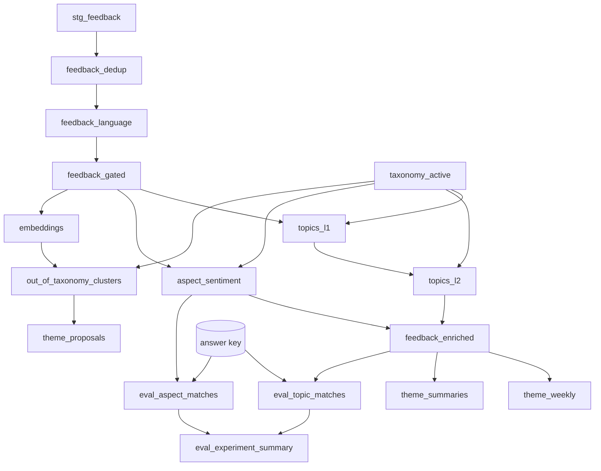

# Materializing the pipeline as a dbt project

The pipeline can be built as plain SQL or as a **dbt project deployed into Snowflake**. dbt is the
better default once past first demo: taxonomy versions, experiment comparison and accuracy regression
gates are exactly what version control, a real DAG and dbt tests are good at.

**Delegate the dbt mechanics.** This file covers what the models are and why they are materialized
the way they are. For `snow dbt deploy`, `EXECUTE DBT PROJECT`, project-object versioning, scheduling
and CI, load the **`dbt-projects-on-snowflake`** skill. Do not reproduce its guidance here.

## Phase-to-model mapping

```
staging/        stg_feedback                 view          union of sources, renamed, typed
                stg_products                 view
taxonomy/       taxonomy_active              view          VOC_TAXONOMY filtered to the pinned version
                taxonomy_l1_categories       view
                taxonomy_l2_categories       view
normalize/      feedback_dedup               table         canonical ids, exclusion reasons
                feedback_language            table         AI_TRANSLATE where needed
                feedback_gated               table         relevance gate, redaction, SKU linking
enrich/         topics_l1                    incremental   AI_CLASSIFY, multi-label
                topics_l2                    incremental   AI_CLASSIFY within assigned L1
                aspect_sentiment             incremental   AI_SENTIMENT, aspects in batches of <= 10
                feedback_enriched            incremental   one row per item, arrays of topics/aspects
themes/         embeddings                   incremental   AI_EMBED
                theme_weekly                 table         counts, baseline, z-score
                out_of_taxonomy_clusters     table         novelty clusters
                theme_proposals              incremental   AI_COMPLETE names for clusters
                theme_summaries              incremental   AI_SUMMARIZE_AGG / AI_AGG
evaluation/     eval_topic_matches           incremental
                eval_aspect_matches          incremental
                eval_experiment_summary      incremental
quality/        quality_log                  incremental   every NULL and error, per stage
```



## Materialization choices, and why each one

| Layer | Materialization | Reason |
|---|---|---|
| `staging`, `taxonomy` | `view` | Renaming and filtering only. No AI calls, nothing to cache. |
| `normalize` | `table` | Contains `AI_TRANSLATE`, `AI_REDACT` and the relevance gate. A view re-invokes and re-bills inference on every downstream select. |
| `enrich`, `themes/embeddings`, `themes/theme_proposals`, `themes/theme_summaries` | `incremental` | Two reasons: new feedback arrives daily and only new items should be classified; and experiments must accumulate (below). |
| `themes/theme_weekly`, `themes/out_of_taxonomy_clusters` | `table` | Pure SQL over enriched rows; cheap to rebuild and must reflect the full window every run. |
| `evaluation`, `quality` | `incremental` | So runs accumulate and can be compared. |

### Incremental on enrichment has two keys, not one

Enrichment must be incremental over **new feedback** and accumulate over **experiments**. Those pull
in different directions: the first wants "skip items already classified", the second wants "classify
again under a new experiment". Make the unique key carry both:

```sql
{{ config(
    materialized = 'incremental',
    unique_key = ['experiment_id', 'taxonomy_version', 'feedback_id', 'level'],
    incremental_strategy = 'merge',
    on_schema_change = 'append_new_columns'
) }}

SELECT
    '{{ var("run_id") }}'            AS run_id,
    '{{ var("experiment_id") }}'     AS experiment_id,
    '{{ var("taxonomy_version") }}'  AS taxonomy_version,
    '{{ var("prompt_version") }}'    AS prompt_version,
    g.feedback_id,
    'L1'                             AS level,
    AI_CLASSIFY(g.text_for_ai, c.categories,
                {'task_description': '{{ var("l1_task_description") }}',
                 'output_mode': 'multi'},
                TRUE)                AS raw_response
FROM {{ ref('feedback_gated') }} g
CROSS JOIN {{ ref('taxonomy_l1_categories') }} c
WHERE g.is_included

  -- Only items not yet classified under THIS experiment and taxonomy version.
  -- Without this, every run re-classifies the full history.
  AND NOT EXISTS (
      SELECT 1 FROM {{ this }} t
      WHERE t.feedback_id = g.feedback_id
        AND t.experiment_id = '{{ var("experiment_id") }}'
        AND t.taxonomy_version = '{{ var("taxonomy_version") }}'
        AND t.level = 'L1'
        AND t.raw_response:error IS NULL)   -- errored rows are retried

```

The `raw_response:error IS NULL` clause makes retries cheap: rows that errored are picked up on the
next run, rows that succeeded are not re-billed.

## Project configuration

```yaml
# dbt_project.yml
name: voice_of_customer
version: 1.0.0
profile: voice_of_customer

vars:
  run_id: "manual"
  experiment_id: "exp_001"
  experiment_name: "baseline taxonomy v1"
  prompt_version: "v1"
  taxonomy_version: "v1"
  l1_task_description: "Assign every topic this customer feedback discusses. Use Other Feedback only when no other topic applies."
  embed_model: "snowflake-arctic-embed-l-v2.0"   # verify at preflight
  label_model: "claude-sonnet-4-5"               # verify GA and region at preflight
  min_acceptable_topic_f1: 0.0
  min_acceptable_aspect_f1: 0.0

models:
  voice_of_customer:
    staging:    {+materialized: view}
    taxonomy:   {+materialized: view}
    normalize:  {+materialized: table}
    enrich:     {+materialized: incremental}
    themes:     {+materialized: table}
    evaluation: {+materialized: incremental}
    quality:    {+materialized: incremental}
```

Override `themes/embeddings`, `themes/theme_proposals` and `themes/theme_summaries` to
`incremental` in their own config blocks.

## Use dbt tests as real quality gates

```yaml
# models/enrich/schema.yml
version: 2
models:
  - name: feedback_enriched
    columns:
      - name: feedback_id
        tests: [not_null]
      - name: taxonomy_version
        tests: [not_null]
      - name: topics_l1
        tests:
          - not_null            # an empty array is allowed; NULL means an unaccounted error
  - name: aspect_sentiment
    columns:
      - name: sentiment
        tests:
          - accepted_values:
              values: ['positive', 'negative', 'neutral', 'mixed', 'unknown']
```

```sql
-- tests/assert_topics_are_in_taxonomy.sql
-- Every assigned label must exist in the taxonomy version the run used.
-- AI_CLASSIFY is constrained to the supplied categories, so a failure here
-- means labels were joined against the wrong taxonomy version.
SELECT t.feedback_id, t.topic_l1, t.topic_l2, t.taxonomy_version
FROM {{ ref('topics_flat') }} t
LEFT JOIN {{ source('taxonomy', 'voc_taxonomy') }} x
  ON x.taxonomy_version = t.taxonomy_version
 AND x.topic_l1 = t.topic_l1
 AND (t.topic_l2 IS NULL OR x.topic_l2 = t.topic_l2)
WHERE x.topic_l1 IS NULL
```

```sql
-- tests/assert_errors_are_logged.sql
-- A NULL classification with no quality-log entry is a silent failure.
SELECT e.feedback_id
FROM {{ ref('topics_l1') }} e
WHERE e.raw_response:value IS NULL
  AND NOT EXISTS (SELECT 1 FROM {{ ref('quality_log') }} q
                  WHERE q.feedback_id = e.feedback_id AND q.stage = 'topics_l1'
                    AND q.run_id = e.run_id)
```

```sql
-- tests/assert_no_double_counting.sql
-- Canonicalised duplicates must not reach enrichment.
SELECT canonical_feedback_id, COUNT(*) AS n
FROM {{ ref('feedback_gated') }}
WHERE is_included
GROUP BY 1 HAVING COUNT(*) > 1
```

```sql
-- tests/assert_accuracy_has_not_regressed.sql
SELECT experiment_id, l1_micro_f1, aspect_micro_f1
FROM {{ ref('eval_experiment_summary') }}
WHERE run_id = '{{ var("run_id") }}'
  AND (l1_micro_f1 < {{ var('min_acceptable_topic_f1') }}
       OR aspect_micro_f1 < {{ var('min_acceptable_aspect_f1') }})
```

Set both thresholds to `0.0` on the first run, then raise to just under the achieved figures so a
regression breaks the build.

## Platform gotchas

1. **dbt writes to `<DATABASE>.<SCHEMA>_<SCHEMA>`** when `+schema:` is set alongside a profile target
   schema. Override `generate_schema_name`:

   ```sql
   
       {{ custom_schema_name | trim if custom_schema_name else target.schema }}
   
   ```

2. **Do not set `authenticator: externalbrowser`** in a profile used by dbt on Snowflake; the session
   is already authenticated.
3. **Pass `return_error_details => TRUE` on every AI function in a model.** One failing row otherwise
   becomes a silent `NULL` rather than an inspectable error.
4. **Never commit a real `profiles.yml`**, and never default the run role to `ACCOUNTADMIN`.
5. **`ARGS` on `EXECUTE DBT PROJECT` is a dbt CLI string**, not JSON:

   ```sql
   EXECUTE DBT PROJECT db.schema.voice_of_customer_project
     ARGS = 'run --target prod --vars {"run_id": "r012", "experiment_id": "exp_002", "taxonomy_version": "v2"}';
   ```

   Verify flags against the supported-commands page via `dbt-projects-on-snowflake`.
6. **`ACCOUNT_USAGE.DBT_PROJECT_EXECUTION_HISTORY`** gives per-run observability. Prefer it over logs.
7. **Jinja and the taxonomy.** Do not template the category list into SQL text from a YAML file; read
   it from `taxonomy_l1_categories` at run time. A templated list drifts from the governed table and
   the `assert_topics_are_in_taxonomy` test is the only thing that will notice.

## Choosing plain SQL instead

Plain SQL is right for a time-boxed proof of value or a team with no dbt practice. Record
`materialization.mode: sql` and the skills emit `CREATE OR REPLACE TABLE` and `INSERT ... SELECT`
statements, with streams and tasks for the incremental path (see `summarize-voc-themes`,
"Incremental pipeline").

What is given up: version control on transformations, lineage, and the test-as-quality-gate
mechanism above. With plain SQL, the gate checks in each skill must be run by hand every time; say so.
